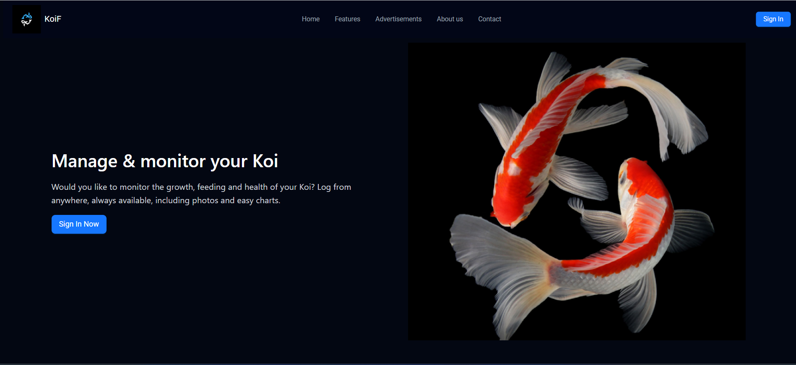
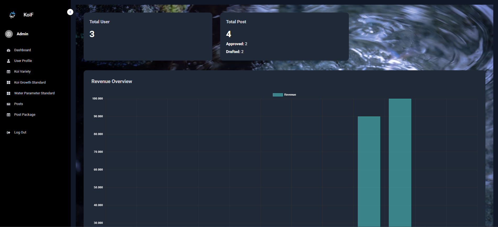
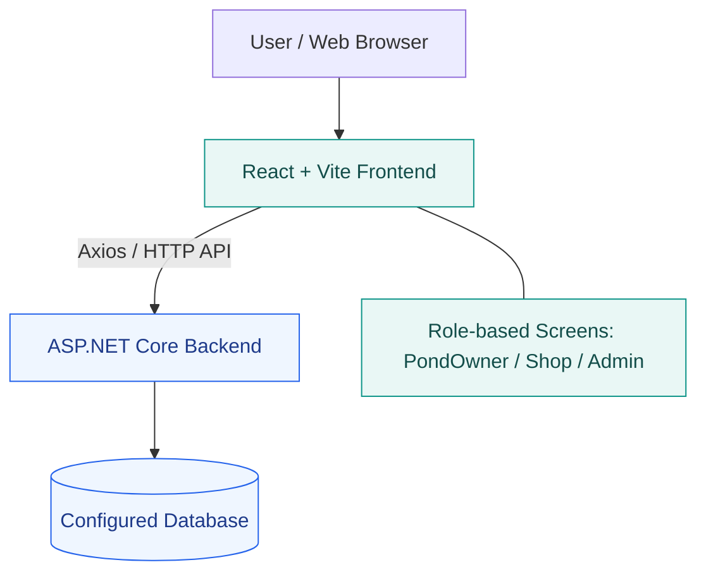

<!-- KoiCareAtHome — GitHub project README -->

<div align="center">

# 🐟 KoiCareAtHome

### Koi Pond & Fish Care Management Platform

A full-stack web application that helps koi enthusiasts manage ponds, track fish growth, monitor water quality, and make informed day-to-day care decisions.

<p>
  
  
  
  
</p>

**Frontend:** Deployed on Vercel · **Backend:** Cloud deployment pending

[Source Code](https://github.com/namt-fptu/SWP391_KoiCareAtHome) · [Architecture Explorer](https://gitdiagram.com/namt-fptu/swp391_koicareathome)

<!-- Add your actual deployed frontend URL once available:
[Live Frontend Demo](https://YOUR-PROJECT.vercel.app)
-->

</div>

---

## Overview

**KoiCareAtHome** is a web-based koi care management system developed as part of **SWP391 — Software Development Project**. It brings together essential koi-keeping tasks in one place: recording pond information, managing individual fish profiles, following growth over time, tracking water conditions, and using care-related calculators.

The application also includes dedicated interfaces for pond owners, shops, and administrators, supporting different workflows within a shared platform.

## Description

Maintaining a healthy koi pond requires keeping track of multiple factors, including fish development, pond specifications, feeding requirements, and water quality. Managing these details across notes and spreadsheets can make routine care difficult.

KoiCareAtHome addresses this problem through a centralized dashboard and structured workflows. Pond owners can organize information about their ponds and koi, review changes over time, and use the application's calculators and water-parameter guidance. Shop and administrator interfaces extend the system with product, content, reference-data, and account-management screens.

## Project Information

| Item | Details |
| --- | --- |
| Project | KoiCareAtHome — Koi Care Management System |
| Course | SWP391 — Software Development Project |
| Institution | FPT University |
| Project type | Academic full-stack web application |
| Repository | [namt-fptu/SWP391_KoiCareAtHome](https://github.com/namt-fptu/SWP391_KoiCareAtHome) |
| Current hosting | Frontend on Vercel; Backend not yet publicly deployed |

> **For recruiters:** The frontend has been deployed, but the backend is not yet hosted publicly. Features that require API access may not work in the online frontend demo until the backend deployment and database configuration are complete. The source code is available for technical review.

## Screenshots

Screenshots of the application will be added after the relevant pages are captured. Suggested views include the landing page, pond dashboard, koi profiles, water parameter tracking, shop management, and admin dashboard.

<!--
To display actual screenshots, create a screenshots/ folder in the repository,
add the image files, and uncomment/update the references below:


*Landing page and navigation*


*Pond owner overview*


*Koi profiles and growth tracking*


*Water quality monitoring*


*Shop management interface*


*Administration dashboard*
-->

## Features

### Core Features — Pond Owners

1. **Pond Management**
   - Maintain pond names, images, dimensions, depth, and volume.
   - Record technical specifications such as drain count and pump capacity.
   - Organize fish information by pond.

2. **Koi Fish Management & Growth Tracking**
   - Manage koi profiles, including name, image, breed, age, sex, appearance, size, weight, origin, and current pond.
   - Update growth records and review development trends with charts.
   - Access koi-related reference information.

3. **Water Quality Monitoring**
   - Record water temperature, salinity, pH, dissolved oxygen, NO2, NO3, and PO4.
   - Follow changes in pond conditions over time.
   - Review recommendations when recorded parameters are outside expected ranges.

4. **Care Calculators**
   - Estimate feeding quantities based on koi growth and care needs.
   - Calculate pond salt requirements.

5. **Insights & Learning Resources**
   - Access statistics, reports, blogs, and informational content about koi care.

### Additional Workflows

**Shop interface**
- Shop overview and profile screens.
- Product and post management screens.
- VIP package and payment-history interfaces.

**Administrator interface**
- Administration dashboard and user-management screens.
- Management interfaces for koi varieties and growth standards.
- Water-parameter standards, posts, and posting packages.

**Authentication & access**
- Sign-in and sign-up screens.
- Role-aware frontend routing for `PondOwner`, `Shop`, and `Admin`.
- Axios-based API integration with bearer-token support.

> Feature descriptions reflect the repository's documented scope and frontend routes. Availability of complete end-to-end workflows depends on backend services and configuration.

## Tech Stack

### Frontend


- **React 18 & Vite 5** — component-based user interface and frontend tooling.
- **React Router** — client-side navigation and role-aware routes.
- **Tailwind CSS, Ant Design & Sass** — layout, components, and styling.
- **Axios & TanStack React Query** — HTTP requests and server-state management.
- **Zustand** — client-side state management.
- **Chart.js / react-chartjs-2** — data visualizations and statistics.
- **Firebase SDK** — included in the frontend dependencies.

### Backend


- **ASP.NET Core / C#** — backend application and API layer.
- **HTTP API** — used by the React frontend for data and authentication workflows.
- **Database** — requires local or hosted backend database configuration; exact database engine and setup should be verified in the backend project.

### Development & Hosting


- **Git & GitHub** — version control and source management.
- **Vercel** — frontend hosting.
- **Visual Studio / VS Code** — local development.

## Architecture



The frontend is a React single-page application. Its routes separate pond-owner, shop, and administrator experiences. The backend provides the application API and connects to the configured database.

**Deployment note:** The frontend is hosted on Vercel; the backend and its database still require cloud hosting before the full application can be demonstrated online.

## Project Structure

```text
SWP391_KoiCareAtHome/
├── BE/
│   └── SWP391.KoiCareSystemAtHome.Fa24/   # .NET backend solution/projects
├── FE/
│   ├── public/                           # Static assets
│   ├── src/
│   │   ├── component/                   # Domain UI components and dashboards
│   │   ├── config/                      # API configuration (Axios)
│   │   ├── page/                        # Pages and role-specific layouts
│   │   ├── routes/                      # Route helpers
│   │   ├── App.jsx                      # Application routes
│   │   └── main.jsx                     # React application entry point
│   ├── index.html
│   ├── package.json
│   └── vite.config.js
└── README.md
```

## Building and Usage

### Prerequisites

- **Git**
- **Node.js 18+** and **npm** for the Vite frontend
- A **.NET SDK** compatible with the backend project's target framework
- A configured **database** and any required backend service settings

### Installation

**1. Clone the repository**

```bash
git clone https://github.com/namt-fptu/SWP391_KoiCareAtHome.git
cd SWP391_KoiCareAtHome
```

**2. Start the frontend**

```bash
cd FE
npm ci
npm run dev
```

Open the URL displayed by Vite in the terminal (typically `http://localhost:5173`).

To create a production frontend build:

```bash
npm run build
npm run preview
```

**3. Run the backend locally**

1. Open `BE/SWP391.KoiCareSystemAtHome.Fa24/` in Visual Studio or locate its solution and Web API `.csproj` file.
2. Install the .NET SDK version required by that project.
3. Set up the database and required configuration values in a secure, local-only configuration source.
4. Restore dependencies, select the API startup project, and run it.
5. Confirm the backend's listening address before connecting the frontend.

> The exact backend start command and database initialization steps depend on the `.csproj`, startup project, and database configuration. They are intentionally not guessed here.

### API Configuration

The frontend's Axios configuration in the original repository is located at:

```text
FE/src/config/axios.jsx
```

The checked-in version uses `http://localhost:5088/api/` as its API base URL. To use a deployed backend, update the configuration to reference the public HTTPS API address, ideally through a Vite environment variable such as `VITE_API_BASE_URL`.

Example for a frontend that has been updated to read that variable:

```env
VITE_API_BASE_URL=https://your-api-host.example.com/api/
```

Do not commit passwords, database connection strings with credentials, private keys, or other secrets. Variables exposed through Vite's `VITE_` prefix are bundled into client-side code and must not contain sensitive values.

## Deployment Status

| Component | Current status | Notes |
| --- | --- | --- |
| Frontend | **Deployed** | Hosted on Vercel; add the actual public link above |
| Backend API | **Not yet deployed** | Currently requires a local or separately configured environment |
| Database | **Cloud setup not yet confirmed** | Required for end-to-end API functionality |
| Full online demonstration | **In progress** | Will be available after backend integration |

## Next Steps

- Deploy the ASP.NET Core API and configure its database securely.
- Connect the Vercel frontend to the hosted API through an environment-based URL.
- Add real application screenshots and a public demo link to this README.
- Document backend-specific prerequisites and exact startup instructions.

---

<div align="center">

**KoiCareAtHome** · SWP391 — Software Development Project

[Back to top](#-koicareathome)

</div>
